# ha-meal-card

[](https://www.home-assistant.io/integrations/marketplace/)
[](https://github.com/juju35/ha-meal-card/actions/workflows/hacs.yml)
[](https://github.com/juju35/ha-meal-card/actions/workflows/validate.yml)
[](https://github.com/juju35/ha-meal-card/actions/workflows/lint.yml)
[](https://github.com/juju35/ha-meal-card/releases/latest)
[](https://github.com/juju35/ha-meal-card/blob/main/LICENSE)
[](https://buymeacoffee.com/julienstep9)

<p align="center"></p>

<p align="center">
  &nbsp;&nbsp;
  &nbsp;&nbsp;
  &nbsp;&nbsp;
  &nbsp;&nbsp;
  &nbsp;&nbsp;
  
</p>

A Lovelace card for **the week's meal plan** and the **shopping list**: tonight's dinner at a glance, today's lunch, the week day by day as plates, and the shopping list to tick off.

[](https://my.home-assistant.io/redirect/marketplace_repository/?owner=juju35&repository=ha-meal-card&category=plugin)

| Card | Type | What it shows |
|---|---|---|
| [Meal](#screenshots) | `custom:meal-card` | Tonight's dinner with its time and servings, today's lunch, the week as plates, and the shopping list to tick off. |
| [Meal mini](#meal-mini) | `custom:meal-mini-card` | Tonight's dinner and what is left to buy on two lines, with a zoom to the full card. |

| Dinner planned | Nothing tonight |
|---|---|
| 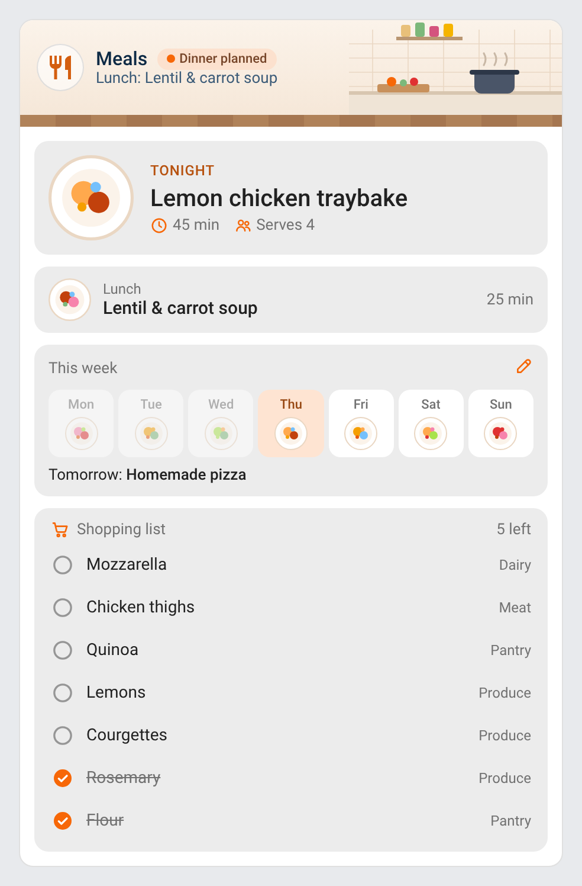 | 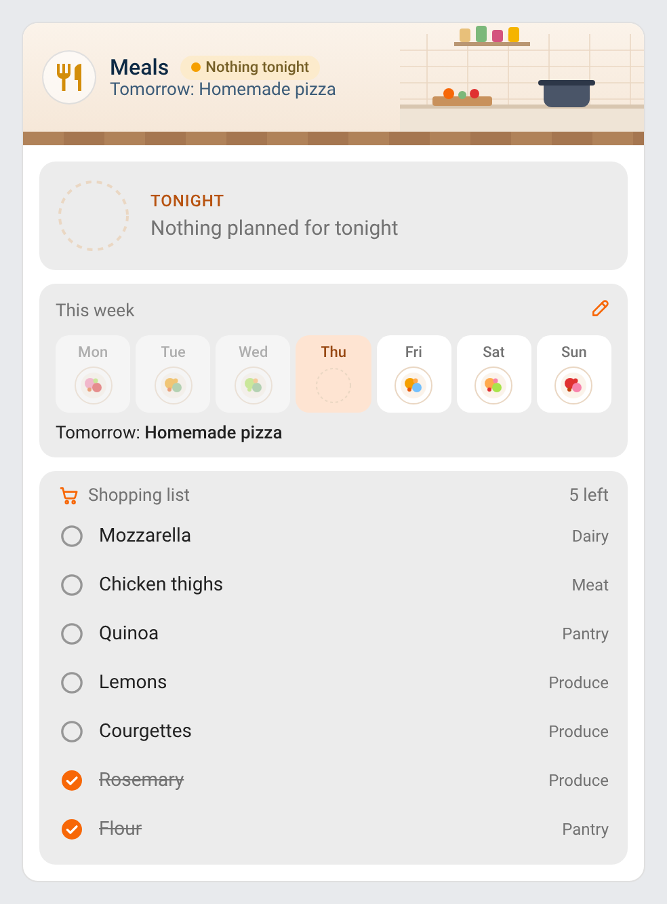 |

## Features

- **Tonight first**: tonight's dinner in big, with a plate drawn in colours picked from the dish's name, its time and its servings; *Nothing planned for tonight* when the plan has no dinner today
- **Today's lunch** on a line, with its time
- **The week as plates**: Monday to Sunday (or the next 7 days), a plate per day, today marked, the past faded, a dashed plate when nothing is planned; hover a day for its meals; tomorrow's dinner under it
- **The shopping list to tick off**: what is left to buy first, by aisle when the items carry one, then what was bought, struck through; a tap ticks an item off (or puts it back) on the to-do list
- **Illustrated header**: a kitchen corner whose pot steams while a dinner is planned tonight; the dark theme darkens it
- **Mini card**: the state, tonight's dinner and what is left to buy; its zoom button opens the full card in place
- Visual editor for both cards, light and dark themes, 22 languages, no external dependency

## Supported integrations

The card reads the meal plans of these integrations (Mealie's meal plan action, Mealie's and Cookidoo's calendars, Grocy's meal plan sensor, and any calendar listed in `meal_plan`), and takes any `todo` list for the shopping:

| | Integration | What the cards show |
|:---:|---|---|
|  | [Mealie](https://www.home-assistant.io/integrations/mealie/) (built in) | Meal plan, recipes and shopping lists |
|  | [Grocy](https://github.com/custom-components/grocy) (Marketplace) | Meal plan, stock and shopping list |
|  | [KitchenOwl](https://github.com/TomBursch/kitchenowl-ha) (Marketplace) | Shopping list |
|  | [Cookidoo](https://www.home-assistant.io/integrations/cookidoo/) (built in) | Thermomix recipes, calendar and shopping list |
|  | [Bring!](https://www.home-assistant.io/integrations/bring/) (built in) | Shopping list |
|  | [OurGroceries](https://www.home-assistant.io/integrations/ourgroceries/) (built in) | Shopping list |

## Installation

### Via the Marketplace (recommended)

Click the button below to add the repository directly:

[](https://my.home-assistant.io/redirect/marketplace_repository/?owner=juju35&repository=ha-meal-card&category=plugin)

Or manually:

1. Open **Settings → Marketplace → Add from link** (top right; this needs a GitHub account connected)
2. Add `https://github.com/juju35/ha-meal-card` — Type: **Dashboard**
3. Open **Meal Card** and click **Install**
4. Clear your browser cache and refresh

The Marketplace registers the dashboard resource for you.

### Manual

1. Download `ha-meal-card.js` and the `ha-meal-card.i18n.*.js` translation files from the [latest release](https://github.com/juju35/ha-meal-card/releases/latest)
2. Copy them all to `/config/www/` (without the translation files, the cards show in English)
3. Go to **Settings → Dashboards → Resources** → Add resource:
   - URL: `/local/ha-meal-card.js`
   - Type: **JavaScript Module**
4. Clear your browser cache and refresh

## Configuration

Every option is in the visual editor. Without any option, the card finds the meal plans (Mealie, Cookidoo, Grocy) and the first shopping list of the home. In YAML:

```yaml
type: custom:meal-card

# A family calendar as the meal plan, the Bring! list, the next 7 days
type: custom:meal-card
meal_plan:
  - calendar.family_meals
shopping_list: todo.bring_groceries
days: next7

# Two lines on a phone dashboard
type: custom:meal-mini-card
```

| Option | Type | Default | Description |
|---|---|---|---|
| `meal_plan` | string or list | Mealie, Cookidoo and Grocy found | Calendars (an event's calendar or summary says its meal type: *breakfast*, *lunch*, *dinner*, *side*; dinner otherwise) or a Grocy meal plan sensor |
| `shopping_list` | string | the first shopping list found | A `todo` entity |
| `title` | string | `Meals` | Both: card title |
| `show_title` | boolean | `true` | Both: show the title |
| `show_subtitle` | boolean | `true` | Both: today's lunch (else tomorrow's dinner) under the title |
| `navigation_path` | string | | Both: a tap on the header opens this dashboard path |
| `days` | string | `week` | `week` (Monday to Sunday) or `next7` (from today) |
| `show_week` | boolean | `true` | The week as plates |
| `show_shopping` | boolean | `true` | The shopping list |
| `shopping_limit` | number | `8` | How many items of the shopping list are shown |
| `illustration` | boolean | `true` | Both: the illustrated header (`false`: the classic header) |
| `illustration_theme` | string | `auto` | Both: `auto` (follows the Home Assistant theme: night with a dark theme, day with a light theme), `day` or `night` |
| `animations` | boolean | `true` | Both: the steam over the pot |
| `zoom` | boolean | `true` | Mini card: the zoom button |
| `language` | string | Home Assistant's | Advanced: one of the [languages](#translations) |

## Screenshots

| Dinner planned | Nothing tonight | Next 7 days, nothing to buy |
|---|---|---|
|  |  | 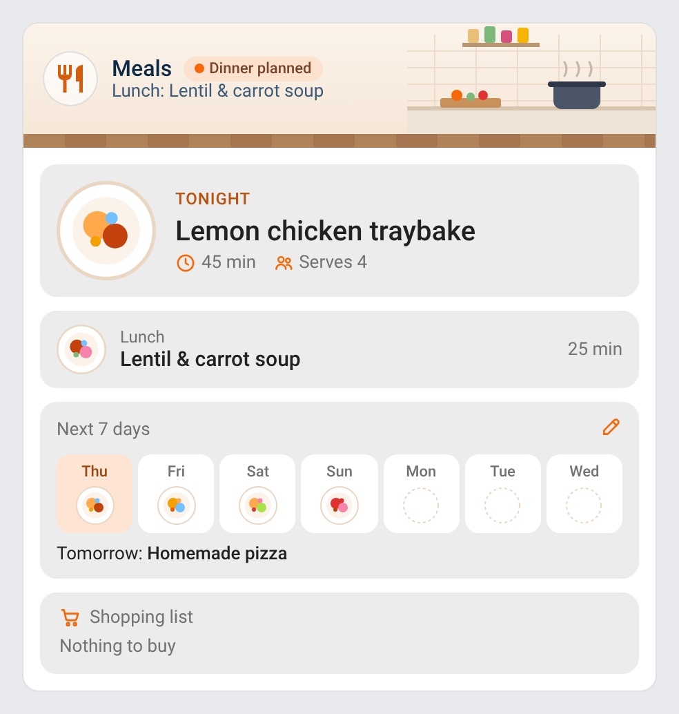 |
| 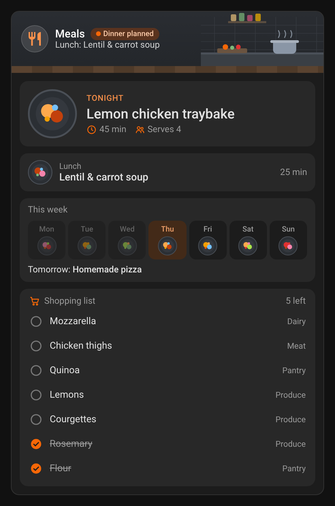 | 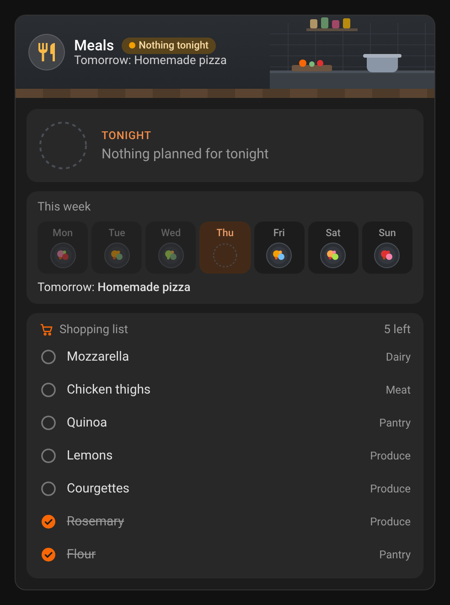 | 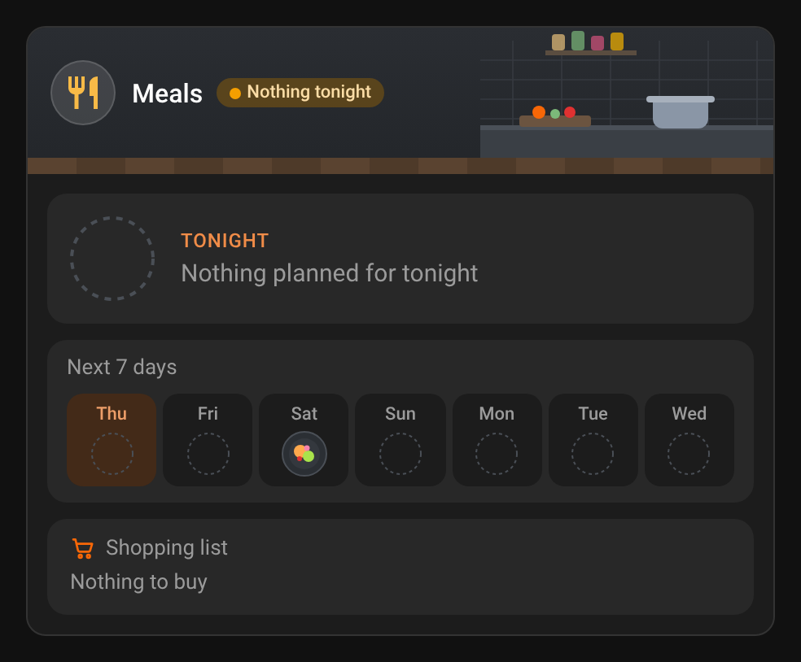 |

| Narrow | Dark |
|---|---|
| 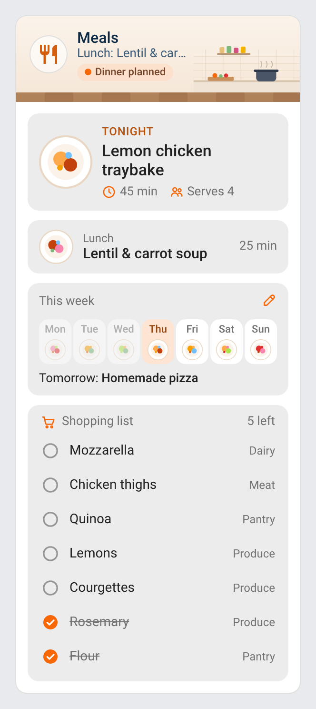 | 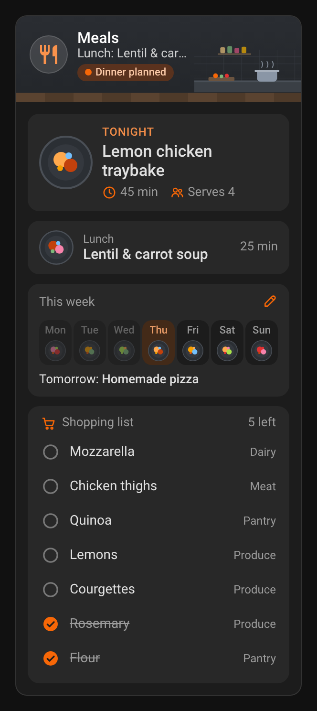 |

**Cooking animation**: the steam rises from the pot while a dinner is planned tonight (still with `animations: false`, or when the system asks for reduced motion).

| Light | Dark |
|---|---|
| 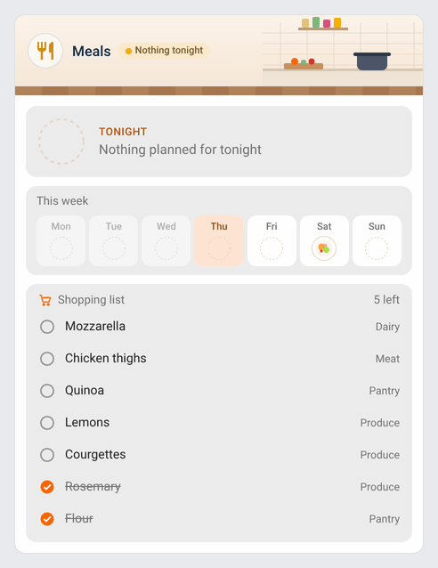 | 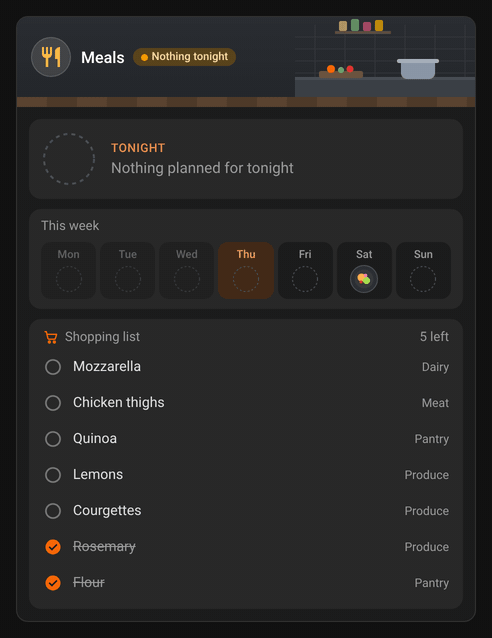 |

### Meal mini

| Dinner planned | Nothing tonight | Zoomed in |
|---|---|---|
|  | 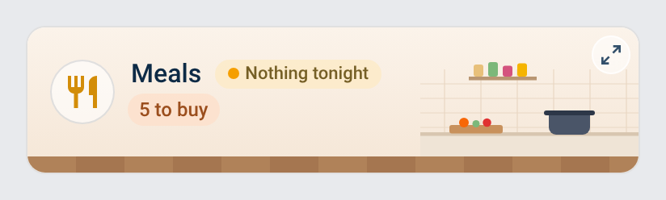 | 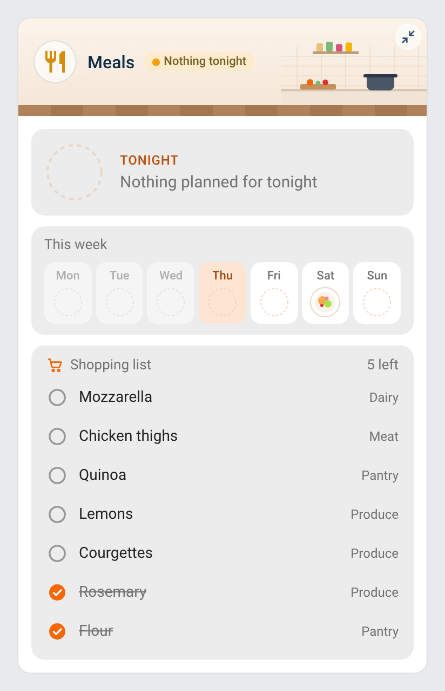 |
| 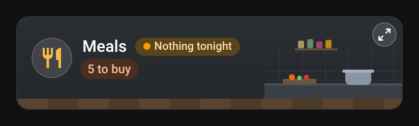 | 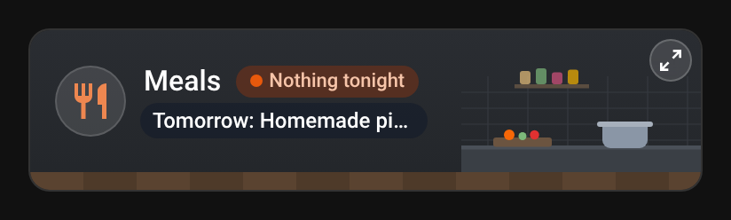 | 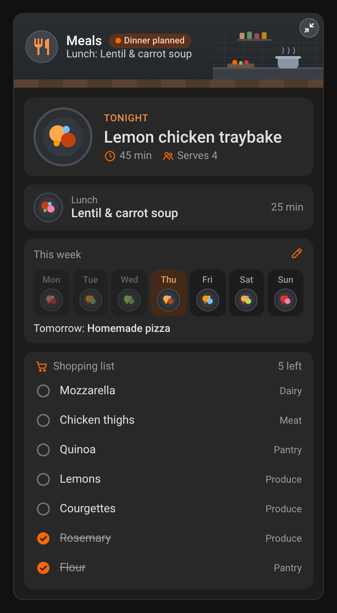 |

| Cooking animation | Dark |
|---|---|
| 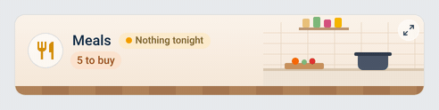 | 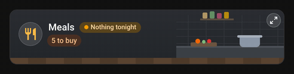 |

## How it works

- **Meal plan**: `meal_plan`, else the home's Mealie and Cookidoo calendars and Grocy meal plan sensor
- **Mealie**: its `mealie.get_mealplan` action for the days shown (each Mealie entry), with the recipes' total time and servings; its calendars are then skipped. Without the action's answer, its calendars are read like any other
- **Calendars**: their events of the days shown (`calendars/<entity>`); the calendar's id or the event's summary says the meal type (*breakfast*, *lunch*, *dinner*, *side*, in several languages), dinner otherwise
- **Grocy**: the `meals` attribute of its meal plan sensor (recipe, product or note, the section as the meal type)
- **Shopping list**: `shopping_list`, else the first to-do list of Mealie, Bring!, OurGroceries, KitchenOwl, Grocy, Cookidoo or the Shopping list integration (one named like a shopping list first); its items (`todo/item/list`), sorted by aisle when their descriptions read like aisles (short words shared by several items); a tap calls `todo.update_item` (`completed` / `needs_action`)
- **Refresh**: at first, every 10 minutes, at each new day, and whenever the shopping list changes
- **Actions**: `todo.update_item` on the shopping list, nothing else

## Development

```bash
npm install
npm run build        # stamps the version of package.json into dist/ha-meal-card.js
npm run check        # builds and checks the bundle (run in CI)
npm test             # unit tests
npm run screenshots  # renders the cards with a mock meal plan into screenshots/ (and the GIFs, needs ffmpeg)
```

`dist/` is not committed: `npm run build` creates it locally, CI builds it on every push, and the release workflow attaches the built files to the release, which is where the Marketplace installs them from.

### Releasing

1. Bump `version` in `package.json`
2. Add a `## <version>` section at the top of [CHANGELOG.md](https://github.com/juju35/ha-meal-card/blob/main/CHANGELOG.md)
3. Push to `main`: the **Release** workflow builds the card, creates the tag and the GitHub release with the changelog section as notes, and attaches `ha-meal-card.js` and its translation files

## Translations

The card auto-detects the language from your Home Assistant settings. Currently supported:

| Language | Code |
|---|---|
| English | `en` |
| Français | `fr` |
| Deutsch | `de` |
| Español | `es` |
| Српски | `sr` |
| Srpski (latinica) | `sr-Latn` |
| Italiano | `it` |
| Nederlands | `nl` |
| Português (Portugal) | `pt` |
| Polski | `pl` |
| Română | `ro` |
| Dansk | `da` |
| Svenska | `sv` |
| Български | `bg` |
| Русский | `ru` |
| Українська | `uk` |
| Magyar | `hu` |
| Slovenčina | `sk` |
| Čeština | `cs` |
| Slovenščina | `sl` |
| Latviešu | `lv` |
| Ελληνικά | `el` |

Contributions for additional languages are welcome!

## License

[MIT](https://github.com/juju35/ha-meal-card/blob/main/LICENSE)

## Support

If you find this project useful, you can support its development:

<a href="https://buymeacoffee.com/julienstep9"></a>
